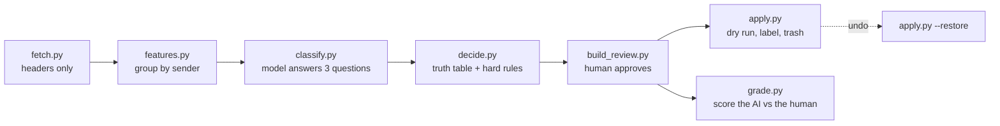

# Gmail Cleanup: AI inbox triage with a human in charge

**It sorts years of Gmail by sender, asks a small AI model what kind of mail each sender sends, and recommends what can go. You approve on a review page. Only then does anything move, and every move can be undone.**

I ran it on my own mailbox: **41,803 emails, 2,694 senders, about $0.19 in AI cost.** 15,340 emails from 695 senders went to Trash with **one wrong call** in 547 graded senders, and that one was caught before anything moved.

Built November 2026 with Claude Code. Python standard library only, plus a small Node script for the Google sign-in.

## The design: AI judges, code decides, a human approves

Letting an AI delete email is a trust problem, not a model problem. So the model never decides anything on its own:

1. **The model only answers questions.** For each sender it gets the sender's name, about 10 subject lines and Gmail's short preview. **Never full email bodies.** It answers three questions with probabilities: what kind of mail is this, did a real person write it, and might it be needed later as a record?
2. **A plain truth table decides** Keep, Delete or Review from those answers (`decide.py`, no network). A real person writing it means Keep. A possible record means Keep. Only clear junk with low scores on both means Delete. Everything in between goes to Review.
3. **Hard rules code always enforces, whatever the model says:** starred mail, mail under your own labels, threads you replied in, your own addresses, and anything under 90 days old are never up for deletion. If you open over half of a sender's mail, it goes to Review.
4. **You approve on a review page** that shows each sender, the recommendation and why. It has Unsubscribe buttons too.
5. **Acting is cautious by default.** `apply.py` is a dry run unless you add `--confirm`. It labels first so you can check in Gmail, then moves mail to Trash (30-day restore), never permanent delete. Every run is logged with its message ids, and `--restore <time>` undoes it.



## Tested in stages, graded every time

I didn't trust it on the whole mailbox until it earned it. Each stage had a pass mark: **zero wrong deletes** and under 20% left for review.

| Trial | What | Result |
|---|---|---|
| 1 | 40 hand-picked senders, checked by eye | No wrong deletes, about $0.002 |
| 2a | Newest 1,000 emails, graded | **Grade thrown out.** The "Keep" button was ambiguous (keep the sender, or keep the old emails?). Fixed the wording |
| 2b | Same 1,000, regraded | 91.6% agreement, 13 wrong deletes. Fixed by splitting categories (login codes vs account alerts, job alerts vs real invitations) and adding a "you open these" rule |
| 2c | A fresh 1,000 emails, 72 new senders | **100% agreement, 0 wrong deletes** |
| 3 | Whole mailbox, read-only | 41,803 emails, ~$0.19. Caught a brokerage's tax statements about to be binned; added a rule to send those back to Review. 99.8% agreement on 547 senders |
| 4 | Live, 4 senders, 168 emails | Labelled, checked, trashed and restored. All 168 matched at every step |
| 5 | Live, full | 15,340 emails moved to Trash in two logged runs. Mailbox 41,803 to 26,474 |

`grade.py` compares the AI's picks with mine after each round. Wrong deletes is the number that matters most. Once I've decided a sender, my call is saved and the model is never asked about it again.

**The biggest lesson wasn't about AI.** Trial 2a failed because of a button label. One button must answer one question.

## Privacy and safety

- Only sender, subject and Gmail's preview ever leave the machine.
- The message cache, model answers and review page are stored in a private folder in the user's home directory (`~/.nexus-os/gmail-cleanup/`), never in the project or a synced folder.
- The Google sign-in token and OAuth client live outside the project too. No keys in the code. The model's API key comes from an environment variable.
- Every model request and answer is logged, so any result can be rerun and audited.

## Token and cost control

- **A small, cheap model** (Jev, from TypeSafe) built for structured judgments. It costs fractions of a cent per sender.
- **Judge senders, not emails.** 41,803 emails collapse to 2,694 senders. Only senders whose mail is truly mixed get judged email by email.
- **Never ask twice.** Answered senders are skipped on reruns, and your saved decisions replace the model entirely.
- **The decisions themselves cost nothing.** The truth table, hard rules and grading are plain Python.

## Run order

```
node auth/google.mjs auth        # one-time Google sign-in (labelling and trashing need gmail.modify)
python fetch.py --limit 1000     # 1. headers into the private cache (read-only)
python features.py               # 2. group by sender
python classify.py --limit 30    # 3. ask the model (needs TYPESAFE_API_KEY)
python decide.py                 # 4. Keep / Delete / Review
python build_review.py           # 5. review page; Export saves your approvals
python grade.py trial-2a         # score the AI's picks against yours
python apply.py --label          # 6. dry run, then --label --confirm, then --trash --confirm
python apply.py --restore <time> # undo a trash run
```

Set `GMAIL_CLEANUP_OWN` to your own addresses (comma-separated) so they're always kept. `questions.py` holds every word the model sees, so the prompts are easy to read and audit.

## Tests

`python -I tests/test_decide.py` checks the truth table: a real person means Keep, a possible record means Keep, clear junk means Delete, unsure means Review, and anything that isn't a junk category is never auto-deleted.

---

Built by Joshua with Claude Code, November 2026.
